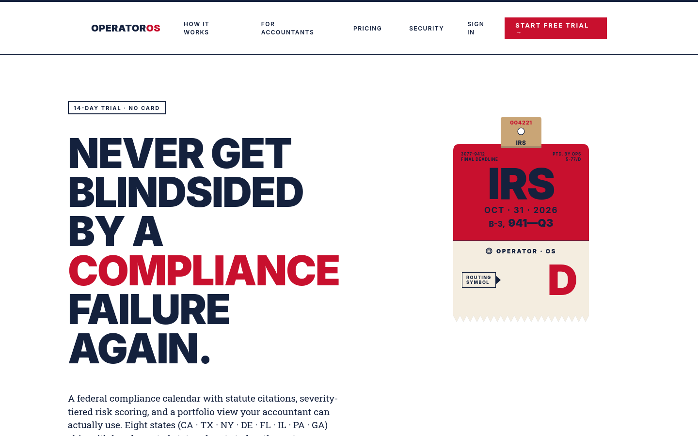

# OperatorOS: a compliance deadline tracker for small businesses

[](LICENSE)

**Live:** https://operatoros-sigma.vercel.app



*Landing page from a production build run locally with placeholder Supabase values, captured 2026-10-24 in Firefox.*

A Next.js and Supabase app that seeds the federal and state compliance deadlines a small business (1–50 employees) is likely to face from its industry, state, entity type and employee count, then tracks a compliance score, sends reminders and gives accountants a portfolio view. It is a demo-stage solo project. Its deadline content is informational, not legal, tax or accounting advice.

## What it does

- **Profile-based deadline seeding.** Onboarding answers select rules from a declarative rule set in `src/lib/regulatory-graph.ts`. The user reviews and edits the list; nothing is filed automatically. Eight states (CA, TX, NY, DE, FL, IL, PA, GA) have curated rules; other states use a template fallback (`EXPLICITLY_HANDLED_STATES` in the same file).
- **Compliance score.** `computeComplianceScore` in `src/lib/deadline-utils.ts` weights each deadline by status; a risk-weighted variant (`computeRiskWeightedScore`) adds severity tiers.
- **AI follow-ups (needs a key).** `src/app/api/ai/compliance-insights/route.ts` sends the business profile and tracked deadlines to Anthropic Claude Haiku and returns 2–3 suggested obligations. Results without an agency and a source URL are dropped, and each carries a "verify with your accountant" line. These are suggestions, not the source of the seeded deadlines.
- **Document expiry extraction (needs a key).** `src/app/api/documents/[id]/extract-expiry/route.ts` reads an uploaded document with Claude.
- **Accountant portal, share links, reminders, billing.** Token-gated accountant and auditor views, Resend email reminders on a daily Vercel cron, and Stripe subscriptions (Business $79/mo, Accountant $299/mo, per `.env.example` and `src/app/(app)/billing/page.tsx`; a Lite tier is reserved but not purchasable).

### Compliance score

| Status | Points | Source |
|--------|--------|--------|
| Compliant | +10 | `STATUS_WEIGHTS` in `src/lib/deadline-utils.ts` |
| Upcoming (due in more than 30 days) | +5 | same |
| In progress (due within 30 days) | 0 | same |
| Overdue | −20 | same |

Score = clamp(sum of points ÷ (deadline count × 10) × 100, 0, 100), rounded. For example, with 10 deadlines of which 9 are compliant and 1 is overdue, the score is 70.

## How it works

Next.js 16 App Router pages and API routes in `src/app/`, Supabase (Postgres, Auth, Storage, row-level security) for data, with schema in `supabase/migrations/` (49 files). Shared logic lives in `src/lib/`: rules (`regulatory-graph.ts`, `seed-deadlines.ts`), scoring (`deadline-utils.ts`), auth and token gates (`security/`), billing, email and entitlements (`entitlements.ts`). `src/proxy.ts` is the Next 16 proxy.

## Run it

Prerequisites: Node.js 20 and npm. The lockfile is `package-lock.json`.

Offline check, no keys or accounts needed:

```bash
npm ci
npm run type-check
npm run lint
npm test          # 376 tests in 38 files passed on 2026-10-24
npm run build     # compiled without any environment variables set
```

Full app, which needs your own services:

```bash
cp .env.example .env.local   # then fill in values
supabase db push             # or run supabase/migrations/ in order
npm run dev                  # http://localhost:3000
```

| Needed for | Variables |
|------------|-----------|
| Database and auth (required) | `NEXT_PUBLIC_SUPABASE_URL`, `NEXT_PUBLIC_SUPABASE_ANON_KEY`, `SUPABASE_SERVICE_ROLE_KEY` |
| AI follow-ups, expiry extraction | `ANTHROPIC_API_KEY` |
| Billing | `STRIPE_SECRET_KEY`, `STRIPE_*_PRICE_ID`, `STRIPE_WEBHOOK_SECRET` |
| Email reminders | `RESEND_API_KEY`, `EMAIL_FROM` |
| Cron endpoints | `CRON_SECRET` |

Also create a private Supabase Storage bucket named `documents`, and point a Stripe webhook at `https://<your-domain>/api/billing/webhook`. See `docs/billing/SETUP.md`. Optional integrations (Twilio SMS, PostHog, QuickBooks, filing providers) are listed in `.env.example`. End-to-end tests use Playwright (`npm run test:e2e`) and need a configured environment; they were not run for this README.

## Repository layout

- `src/app/` routes: app, auth, onboarding, accountant portal, admin, share pages, API
- `src/components/` UI components
- `src/lib/` rules, scoring, security, billing, email
- `supabase/migrations/` database schema and policies
- `docs/` security notes, runbooks, roadmap and historical planning
- `scripts/` Stripe subscription backfill
- `.agents/skills/` design-assistant files used while building (not part of the app)
- `AGENTS.md`, `CLAUDE.md`: agent workflow files used while building (not part of the app)

## Documentation

- `docs/vercel/DEPLOYMENT.md`: deployment checklist and cron jobs.
- `docs/billing/SETUP.md`: Stripe test-mode setup.
- `docs/MIGRATION_RUNBOOK.md`: applying database migrations.
- `docs/security/`: RLS matrix, API route matrix, threat models, CI verification.
- `docs/roadmap/WORLD_CLASS.md`, `docs/vc-review/`, `docs/feedback/`: planning and simulated review notes.
- `docs/historical/`: early pitch and plan. These are not current claims.

## Sources

Rule entries cite the responsible agency and a source URL in `src/lib/regulatory-graph.ts`. They were authored for this project and have not been reviewed by a lawyer, CPA or the agencies. Rule dates and penalty figures can be out of date.

## Scope and limits

- Not legal, tax or accounting advice. Confirm every deadline with your accountant or the responsible agency. The terms page marks its legal text as a draft pending legal review.
- Independent portfolio project. Not affiliated with the IRS, any state agency, Anthropic, Stripe or Supabase.
- The AI features were not exercised for this README because no API key was available; only the code paths were read. Unit tests cover the scoring, rule and security logic.
- The landing page stat "9–20" starter deadlines for a 16–30 employee business is counted from the rule set across 9 states (`src/__tests__/lib/starter-deadline-range.test.ts`). An earlier "47 obligations" figure was removed because the code does not support it. Other landing-page figures (penalty examples, pricing) are not reproduced by tests.
- Counts of customers, revenue or accountant adoption do not exist in this repository. Statements about accountant distribution in older docs are strategy, not results.
- Nothing is filed on a user's behalf. Filing-provider integrations need third-party keys and were not tested.
- `npm audit` reports 0 vulnerabilities on 2026-10-24. Vitest stays on 4.1.12 because Vitest 5 requires Node 22.12 or newer.
- In a local production build (`next build && next start`) Firefox blocked the page's scripts under the strict Content-Security-Policy nonce, so the static landing page did not hydrate. Not investigated or fixed here; check the live site.

## License

MIT, see [LICENSE](LICENSE).

Part of [Rahil Bhavan's projects](https://github.com/RahilBhavan).
